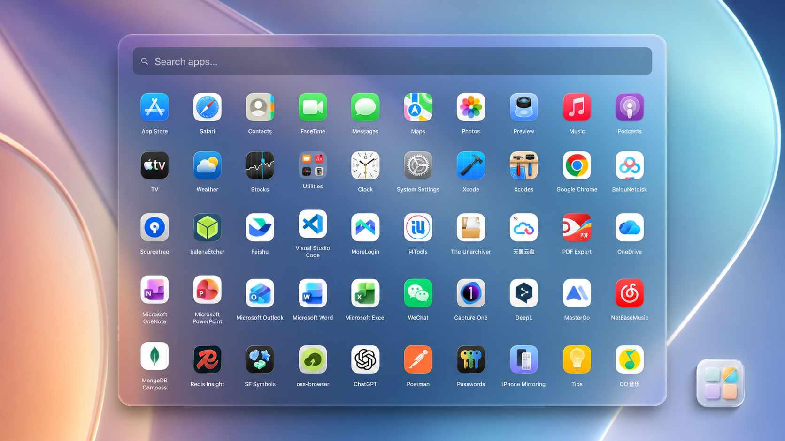

# Facet — a free classic Launchpad replacement for Mac

Facet restores the familiar fullscreen app grid, keyboard search, folders, manual ordering, and Launchpad layout import on modern macOS. The fullscreen launcher and its existing global toggle shortcut remain free. Facet Pro is an optional one-time upgrade for compact mode, advanced customization, and Launch Sets with per-Mode shortcuts.

## Download

- [Download Facet 1.0.28 DMG](https://github.com/QuartzInkStudio/Facet/releases/download/v1.0.28/Facet-1.0.28.dmg) — recommended for manual installation
- [View release notes](https://facetlauncher.com/releases)
- [Homebrew tap](https://github.com/QuartzInkStudio/homebrew-tap)

Facet 1.0.28 requires an Apple silicon Mac running macOS 14.0 or later, including macOS 26 Tahoe. The app is Developer ID signed and Apple-notarized.

| File | SHA-256 |
| --- | --- |
| `Facet-1.0.28.dmg` | `feedbb83b9c318e05ff31f47f209230980e1a989b8cbbce993d32722cfd27262` |
| `Facet-1.0.28.zip` | `e2e2cd010bb458c3e42b9226eab27b178addb2cd384693af3f188378f9a63ad7` |

The ZIP archive attached to the GitHub release is the signed Sparkle update package. For a new installation, use the DMG.

## Facet Free and Facet Pro

| Capability | Facet Free | Facet Pro |
| --- | :---: | :---: |
| Fullscreen visual app grid | Included | Included |
| Keyboard search and app launching | Included | Included |
| Folders, manual ordering, and Launchpad import | Included | Included |
| Global keyboard shortcut | Included | Included |
| Compact launcher mode | — | Included |
| Launch Sets with up to 12 apps per Mode, started on request | — | Included |
| Per-Mode Open Mode and Start Launch Set shortcuts | — | Included |
| Advanced grid, scrolling, wallpaper, and glass controls | — | Included |
| Hot corner, app hiding, and aliases | — | Included |
| Dock and menu bar icon customization | — | Included |
| Price | Free forever | $14.99 USD once for up to 3 Macs |

The optional **14-day Pro trial** starts inside Facet. It requires no card, creates no automatic charge, and is not a subscription. When the trial ends, Facet returns to the Free edition and keeps the user's launcher data. Facet Pro's regular base price is **$14.99 USD once for up to 3 Macs**.

## Highlights

- **Classic visual workflow:** Browse apps by position again instead of relying only on typed search.
- **Fast access:** Open Facet from a global shortcut, the Dock, or the menu bar. Pro also adds a configurable hot corner.
- **Mode Launch Sets:** Configure up to 12 apps per Mode and open them only when you choose Start Launch Set. Opening a Mode shows its apps; switching Modes only changes the visible collection.
- **Folders and layout import:** Preserve familiar organization or build a new custom layout.
- **Responsive app discovery:** Facet starts from a warm app catalog and reconciles newly installed apps promptly.
- **Private by design:** No product analytics, advertising telemetry, or subscription.
- **Native distribution:** Developer ID signed, Apple-notarized, and updated through a signed Sparkle feed.

## Installation

1. [Download Facet 1.0.28's notarized DMG](https://github.com/QuartzInkStudio/Facet/releases/download/v1.0.28/Facet-1.0.28.dmg), or run `brew install --cask QuartzInkStudio/tap/facet`.
2. Open the DMG and drag Facet to the Applications folder.
3. Launch Facet and choose a global keyboard shortcut.
4. Continue with Facet Free, start the optional Pro trial, or activate a Facet Pro license.

## Screenshots

| Wallpaper mode | Keyboard search | Folders |
| :--- | :--- | :--- |
|  |  |  |

## Guides and support

- [Official Facet website](https://facetlauncher.com/)
- [Documentation](https://facetlauncher.com/docs)
- [Compare Launchpad alternatives](https://facetlauncher.com/compare)
- [Get Launchpad back on macOS 26](https://facetlauncher.com/get-launchpad-back-macos-26)
- [Release history](https://facetlauncher.com/releases)
- [Report a bug or request a feature](https://github.com/QuartzInkStudio/Facet/issues)

## 简体中文

Facet 是一款适用于 Mac 的经典 Launchpad 替代工具。全屏应用网格、键盘搜索、文件夹、排序、Launchpad 布局导入和全局快捷键继续免费使用。Facet Pro 是可选的一次性升级，提供紧凑模式、热角和高级自定义。Facet 1.0.28 为 Facet Modes 增加工作启动组和模式快捷键：打开模式只显示其中的 App，启动工作启动组才会打开所选 App；切换模式只改变显示内容。设置或启动工作启动组，以及使用各模式的这两个快捷键，都需要有效的 Pro，试用期间也一样。可在 Facet 内主动开始 14 天试用；无需信用卡，不会自动扣费，也没有订阅。Facet Pro 常规基础价格为 $14.99 USD 一次买断，最多用于三台 Mac。

## 日本語

Facet は Mac 向けのクラシックな Launchpad 代替アプリです。フルスクリーンのアプリグリッド、検索、フォルダ、並べ替え、Launchpad レイアウトの読み込み、グローバルショートカットは無料で使い続けられます。Facet Pro は任意の買い切りアップグレードで、コンパクトモード、ホットコーナー、高度なカスタマイズを追加します。Facet 1.0.28 では作業用アプリセットとモード別ショートカットを追加しました。モードを開くとそのアプリ一覧が表示され、起動セットを開始すると選択したアプリが起動します。モードの切り替えでは表示だけが変わり、アプリは起動しません。作業用アプリセットの設定・開始とモード別ショートカットの使用には、有効な Pro が必要です。任意の 14 日間トライアルは Facet 内で開始でき、カード登録・自動課金・サブスクリプションはありません。Facet Pro の通常基本価格は最大 3 台の Mac で使える $14.99 USD の買い切りです。

## 한국어

Facet은 Mac용 클래식 Launchpad 대체 앱입니다. 전체 화면 앱 그리드, 검색, 폴더, 수동 정렬, Launchpad 레이아웃 가져오기 및 기존 전역 토글 단축키는 계속 무료입니다. Facet Pro는 컴팩트 모드, 핫 코너 및 고급 사용자화를 제공하는 선택형 일회성 업그레이드입니다. Facet 1.0.28은 실행 그룹과 모드별 단축키를 추가합니다. 모드를 열면 앱 목록만 표시되고, 실행 그룹을 시작해야 선택한 앱이 열립니다. 모드 전환은 표시되는 목록만 바꾸며 앱을 실행하지 않습니다. 실행 그룹 구성·시작과 모드별 단축키는 활성 Pro가 필요합니다. 선택형 14일 체험은 Facet 안에서 시작하며 카드, 자동 결제, 구독이 없습니다. Facet Pro의 정가/기준 가격은 최대 세 대의 Mac에서 사용하는 $14.99 USD 일회성 구매입니다.

## Deutsch

Facet ist ein klassischer Launchpad-Ersatz für den Mac. Vollbildraster, Suche, Ordner, manuelle Sortierung, Launchpad-Import und der bisherige globale Umschaltkurzbefehl bleiben dauerhaft kostenlos. Facet Pro ist ein optionaler Einmalkauf für Kompaktmodus, aktive Ecke und erweiterte Anpassungen. Facet 1.0.28 ergänzt App-Startgruppen und Kurzbefehle pro Modus: Das Öffnen eines Modus zeigt seine Apps; erst das Starten der App-Startgruppe öffnet die Auswahl. Ein Moduswechsel ändert nur die angezeigte Sammlung. Das Einrichten und Starten von App-Startgruppen sowie die Kurzbefehle pro Modus erfordern aktives Pro. Die optionale 14-Tage-Testphase startest du in Facet; ohne Karte, automatische Abbuchung oder Abonnement. Der reguläre Basispreis für Facet Pro beträgt einmalig $14.99 USD für bis zu drei Macs.

## Français

Facet est une alternative classique à Launchpad pour Mac. La grille plein écran, la recherche, les dossiers, le classement manuel, l’import de la disposition Launchpad et le raccourci global actuel restent gratuits. Facet Pro est un achat unique facultatif qui ajoute le mode compact, le coin actif et des réglages avancés. Facet 1.0.28 ajoute les groupes de lancement et les raccourcis par mode : ouvrir un mode affiche ses apps, tandis que démarrer le groupe de lancement ouvre les apps sélectionnées. Changer de mode modifie uniquement la collection affichée. Configurer ou démarrer un groupe de lancement et utiliser les raccourcis par mode nécessite Pro actif. L’essai facultatif de 14 jours se démarre dans Facet, sans carte, prélèvement automatique ni abonnement. Le prix habituel de base de Facet Pro est de $14.99 USD en achat unique pour jusqu’à trois Mac.

## Español

Facet es una alternativa clásica a Launchpad para Mac. El lanzador a pantalla completa, la búsqueda, las carpetas, el orden manual, la importación del diseño de Launchpad y el atajo global de alternancia siguen siendo gratis. Facet Pro es una compra única opcional que añade el modo compacto, la esquina activa y personalización avanzada. Facet 1.0.28 añade grupos de inicio y atajos por modo: abrir un modo muestra sus apps; iniciar el grupo de inicio abre las apps seleccionadas. Cambiar de modo solo modifica la colección que muestra Facet. Configurar o iniciar un grupo de inicio y usar los atajos por modo requiere Pro activo. La prueba opcional de 14 días se inicia dentro de Facet, sin tarjeta, cobro automático ni suscripción. El precio normal de referencia de Facet Pro es de $14.99 USD, pago único para hasta tres Mac.

---

## Repository and license

Facet is proprietary commercial software by Quartz. This public repository is a product hub for verified release packages, public documentation, release notes, and issue tracking. **It does not contain the Facet application source code.**

GitHub automatically adds “Source code” archives to each tag. Those archives are snapshots of this public product-hub repository, not the proprietary Facet app source.
